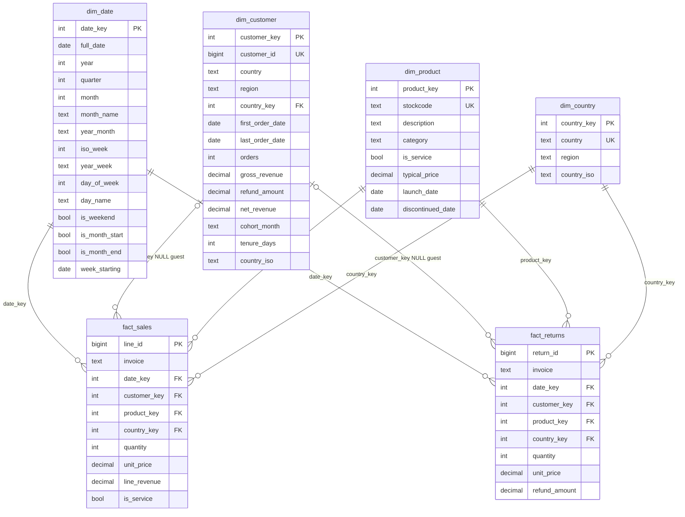
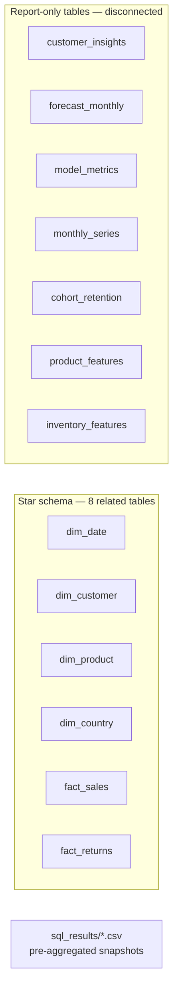

# Data Model — Enterprise Sales Analytics (Power BI)

Authoritative reference for the Power BI semantic model. Rebuild these tables, types, and relationships exactly as documented. All amounts are **GBP (£)**. Source data: UCI Online Retail II (UK online retailer), transactions **2009-12-01 → 2011-12-09**.

- Star schema and flat report tables export to `data/processed/powerbi/*.csv`.
- SQL query snapshots export to `data/processed/sql_results/*.csv`.
- KPI check values: `data/processed/kpi_summary.json`.

---

## 1. Star schema (ER diagram)

### Fact tables

| Table | Grain | Rows | Notes |
|---|---|---|---|
| `fact_sales` | One invoice line | 1,010,534 | `line_id` PK; `customer_key` NULL = guest/anonymous checkout (~23% of lines); `line_revenue = quantity × unit_price`; `is_service` marks postage/manual/sample lines |
| `fact_returns` | One credit (refund) line | 22,497 | `return_id` PK; `refund_amount` positive values; `customer_key` NULL = guest refund |

`fact_sales` and `fact_returns` are **not related to each other**. Both filter through the shared dimensions (primarily `dim_date`, `dim_product`, `dim_country`).

### Dimension tables

| Table | PK | Rows | Notes |
|---|---|---|---|
| `dim_date` | `date_key` (yyyymmdd int) | 739 (2009-12-01 → 2011-12-09) | Daily grain; `year_month` / `year_week` are text (`2010-01`, `2010-W51`) and sort chronologically as-is |
| `dim_product` | `product_key` | ~5,131 (4,813 sold in period: 4,793 product + 20 service) | Product categories: Christmas & Seasonal, Lighting, Bags & Travel, Drinkware, Kitchen & Dining, Home Décor, Stationery & Gifting, Bath & Storage, Toys & Games, Garden & Outdoor, Textiles & Soft Furnishings, Jewellery & Accessories, Other Products; service categories: Postage & Delivery, Manual Adjustments, Bank Charges, Discounts & Giveaways, Samples & Giveaways, Marketplace Fees, Gift Vouchers, Packing & Fixings, Charity Donation; `is_service = TRUE` on service rows |
| `dim_customer` | `customer_key` | 5,881 | Registered customers only (no guest rows); lifetime attributes `orders`, `gross_revenue`, `refund_amount`, `net_revenue`, `cohort_month` (`YYYY-MM` of first order), `tenure_days` |
| `dim_country` | `country_key` | 43 | `region` ∈ {United Kingdom, Europe, Americas, Asia Pacific, Middle East & Africa, Unknown} |

### Relationships (create exactly these 8 — all active, many-to-one, single direction)

| # | Child (many side) | Parent (one side) | Cardinality | Cross-filter | Active |
|---|---|---|---|---|---|
| 1 | `fact_sales[date_key]` | `dim_date[date_key]` | * → 1 | Single (dim → fact) | Yes |
| 2 | `fact_sales[customer_key]` | `dim_customer[customer_key]` | 0..* → 1 (nullable FK) | Single (dim → fact) | Yes |
| 3 | `fact_sales[product_key]` | `dim_product[product_key]` | * → 1 | Single (dim → fact) | Yes |
| 4 | `fact_sales[country_key]` | `dim_country[country_key]` | * → 1 | Single (dim → fact) | Yes |
| 5 | `fact_returns[date_key]` | `dim_date[date_key]` | * → 1 | Single (dim → fact) | Yes |
| 6 | `fact_returns[customer_key]` | `dim_customer[customer_key]` | 0..* → 1 (nullable FK) | Single (dim → fact) | Yes |
| 7 | `fact_returns[product_key]` | `dim_product[product_key]` | * → 1 | Single (dim → fact) | Yes |
| 8 | `fact_returns[country_key]` | `dim_country[country_key]` | * → 1 | Single (dim → fact) | Yes |

Every relationship direction must be **Single** (not Both). Verify in Model view after import; turn off auto-detection if Power BI creates extra paths.

### `dim_country` is intentionally NOT connected to `dim_customer`

`dim_customer` carries its own `country_key`, `country`, `region`, and `country_iso` columns, but **no relationship exists** between `dim_customer` and `dim_country`.

Rules:

- **Ambiguity avoidance.** With `fact_sales[country_key] → dim_country` active, adding `dim_customer[country_key] → dim_country` creates two filter paths from `dim_country` to the facts (direct and via `dim_customer`), producing ambiguous cross-filter behaviour and unreliable slicer results. Do not activate it.
- **Transaction geography** (how sales/returns split by where the order shipped): slice on `dim_country[region]` / `dim_country[country]` — flows through `fact_sales[country_key]` and `fact_returns[country_key]`, includes guest lines.
- **Customer geography** (where customers are registered): use `dim_customer[region]` / `dim_customer[country]` directly. A `dim_customer[region]` slicer filters both facts through `customer_key`, but **drops guest lines** (guest rows have NULL `customer_key`) — use it only when that is intended.
- **If a single customer → country path is ever required**, create it as an *inactive* relationship (`dim_customer[country_key] → dim_country[country_key]`, single direction) consumed with `USERELATIONSHIP`, or bridge the attributes with `TREATPATH` in a helper hierarchy. Never leave two active paths to `dim_country`.

---

## 2. Flat report tables (no model relationships)

Imported as separate tables for visuals. **No relationships to the star schema by default** — measures on these tables must sum their own columns (e.g., `SUM(customer_insights[monetary])`); star measures like `[Net Revenue]` do **not** respond to filters on these tables, and vice versa.

| Table | Grain | Key columns |
|---|---|---|
| `customer_insights.csv` | One row per `customer_id` (5,881) | `customer_id`, `customer_key`, `country`, `region`, `recency_days`, `frequency`, `monetary` (net of refunds), `avg_order_value`, `r_score`, `f_score`, `m_score`, `rfm_segment` (Champions / Loyal Customers / Potential Loyalists / New Customers / At Risk / Hibernating / Lost / Big Spenders), `kmeans_segment`, `churn_probability` (0–1), `risk_level` (High / Medium / Low), `churned_actual` (0/1), `tenure_days`, `return_rate`, `distinct_products` |
| `forecast_monthly.csv` | One row per month × model | `forecast_month` (first-of-month date), `model` (Moving Average / Seasonal Naive / Holt / Holt-Winters — visual filters use **Seasonal Naive**, the best backtest model), `forecast_net_revenue`, `lower_95`, `upper_95`, `actual_net_revenue` (blank for future months) |
| `model_metrics.csv` | One row per model | `model`, `auc`, `accuracy`, `precision`, `recall`, `f1` |
| `monthly_series.csv` | One row per month | `year_month`, `gross_revenue`, `orders`, `units`, `lines`, `active_customers`, `refunds`, `net_revenue`, `new_customers`, `returning_customers`, `aov` |
| `cohort_retention.csv` | One row per cohort | `cohort_month`, then wide columns `0` … `12` holding retention fractions |
| `product_features.csv` | One row per `stockcode` | `stockcode`, `description`, `category`, `units_sold`, `gross_revenue`, `net_revenue`, `orders`, `customers`, `return_rate`, `growth_90d_pct`, `abc_class` (A / B / C), `days_since_last_sale` |
| `inventory_features.csv` | One row per `stockcode` | `stockcode`, `description`, `category`, `units_sold`, `orders`, `last_sale`, `days_since_last_sale`, `stockout_weeks_52w`, `avg_weekly_units`, `reorder_point_units`, `movement_class` (Fast Mover / Normal / Slow Mover / Dead Stock / Service) |
| `sql_results/*.csv` | Pre-aggregated query outputs | `monthly_revenue_trend`, `mom_yoy_growth`, `rolling_averages_daily`, `rfm_segmentation_sql`, `cohort_retention`, `customer_lifetime_value`, `category_performance`, `revenue_waterfall`, `net_revenue_by_region_country`, … — snapshots; they do not respond to slicers |

`kpi_summary.json` (`data/processed/kpi_summary.json`) imports as a single-row reference table: `snapshot_date`, `gross_revenue`, `returns_refunds`, `net_revenue`, `orders`, `lines`, `customers_with_id`, `products`, `countries`, `aov`, `return_rate_pct`, `net_revenue_2010`, `net_revenue_2011_partial`, `yoy_growth_pct`, `guest_line_share_pct`, `churn_rate_pct`, `top_country_share_pct`, `dead_stock_products`, `total_products`.

### Optional relationships (recommended, not required)

The spec model has zero relationships for flat tables. Adding the following four improves slicer interactivity; each is many-to-one, **Single** direction, and creates no ambiguous path:

| Child → Parent | Enables |
|---|---|
| `forecast_monthly[forecast_month]` → `dim_date[full_date]` | Date-range slicer filters all forecast visuals |
| `customer_insights[customer_key]` → `dim_customer[customer_key]` | `dim_customer` attributes/slicers filter customer visuals |
| `product_features[stockcode]` → `dim_product[stockcode]` | Category slicer filters product visuals |
| `inventory_features[stockcode]` → `dim_product[stockcode]` | Category slicer filters inventory visuals |

Notes: `monthly_series[year_month]` and `cohort_retention[cohort_month]` are text and have no unique date column — they stay disconnected; visuals built on them show full-series values regardless of the date slicer. `dim_country[region]` will still not reach `customer_insights` (by design); use `customer_insights[region]` for customer-level geography.

---

## 3. Modelling conventions

- All measures live in a dedicated `_Measures` table (see `README.md`).
- Measure names are unique model-wide. Three measures share a name with flat columns — `[Orders]` (`monthly_series[orders]`, `dim_customer[orders]`), `[AOV]` (`monthly_series[aov]`), `[Units]` (`monthly_series[units]`). Power BI resolves an unqualified `[Name]` reference to the measure; to use the column, qualify it: `'monthly_series'[orders]`.
- `dim_date` should be marked as a Date table (see `README.md`) so `SAMEPERIODLASTYEAR` / `TOTALYTD` behave correctly.
- Hide surrogate keys from report view: `line_id`, `return_id`, `date_key` (both sides), `customer_key`, `product_key`, `country_key`. Keep descriptive columns visible.

